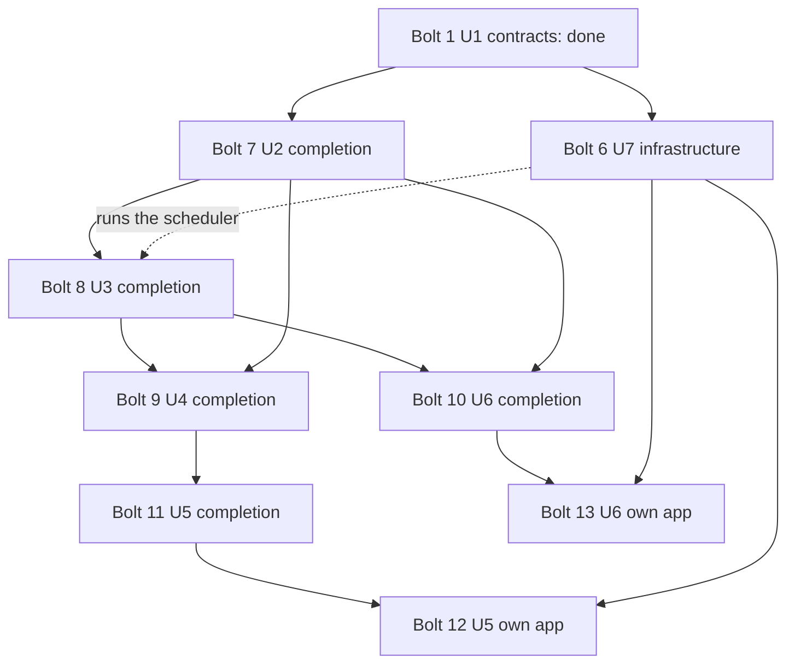

# Bolt Plan — Civic Issue Tracker

A **Bolt** is one build pass over a piece of the work that ends in something that runs. Each Bolt below covers one unit of work (a self-contained piece of the system, defined in `unit-of-work.md`), as you chose [Q4-A], with one exception noted at Bolt 5.

This plan was written after a thin slice was already built directly in `backend/` and `frontend/`. So it has two parts: five Bolts that record what exists (Bolts 1 to 5), and eight Bolts for what is left (Bolts 6 to 13). You chose one Bolt per unit for the built part [Q1-B]. The five built Bolts together make up the thin working slice that proves the design hangs together (the "walking skeleton": the smallest end-to-end slice). The classic plan does not run a separate skeleton approval, so this is a label, not a step.

## How every Bolt is checked

Each Bolt counts as done only when both commands pass [Q8-A]:

- `cd backend && .venv\Scripts\python -m pytest -q` (the README states 49 tests today)
- `cd frontend && npm run build` (type check and build)

Each Bolt also adds tests for what it builds. These two commands are the checks proposed for the construction verification command; you approve them separately when Construction starts.

## Part 1: What is already built (Bolts 1 to 5)

Status values: **Done** means the unit's planned work exists. **Partly done** means the thin slice covers some requirements and the rest moves to a later Bolt. The "Left for" column says where.

| Bolt | Unit | Status | What exists | Left for |
|---|---|---|---|---|
| 1 | U1 contracts (spec unit) | Done as text | All seven contracts, with changes CC-1 to CC-5, in `inception/contract-design/contract-summary.md` | Optional: extract the OpenAPI and AsyncAPI files into U1 as files (not scheduled; see Open questions) |
| 2 | U2 platform services | Partly done | Staff accounts with a second factor (FR16); photo type, size and location-metadata checks (FR1.4, FR3.4); queued email requests | Real email sending and retry (FR2.3, FR5); a real malware scan (NFR15); staff invitations (FR16): Bolt 7 |
| 3 | U3 case workflow | Partly done | Report record, status rules with history, priority, internal note, resolution note, dispute flag, queue (FR7, FR10 to FR13) | Retention purge (FR17); configuration of categories, zones and business hours (FR15.2, FR8.1, FR6.1); check FR6, FR8 and FR14 against the code: Bolt 8 |
| 4 | U4 public-side backend | Partly done | Submit with rate limits and abuse checks, Tracking ID, public tracking view, dispute (FR1 to FR3, FR13, NFR15, NFR16), Dhaka-area check | Magic-link history (FR4, CC-1): Bolt 9 |
| 5 | U5 Citizen Portal and U6 Authority Dashboard, built together as two sections of one app | Partly done | Report form with map pin and place search, confirmation, tracking page; staff sign-in, queue, report detail, acknowledge, priority, status moves | Personal history screen (FR4), map provider change (risks R1, R2), staff invitation screen, two separate apps: Bolts 10 to 13 |

Bolt 5 is the one exception to one unit per Bolt: the two screens were built as one app, so one record covers both.

Not stated in the README, so to be checked against the code at the start of Bolt 8 rather than assumed: FR6 (24-hour acknowledge measure), FR8 (filters, which the staff screen shows), FR14 (reopen), FR15 (categories).

## Part 2: What is left (Bolts 6 to 13)

The order follows your mix [Q2-D]: safety and launch blockers first (risk-first), then citizen and staff features (value-first), then the two-app split last. Bolts in the same wave can be built at the same time [Q5-C]. Every Bolt is owned by the developer agent, the AI that builds the code, because the team-formation stage did not run (see `team-allocation.md`).

### Wave 1 (start now, in parallel)

#### Bolt 6 — U7 infrastructure and deployment

- **Units:** U7 (packaging unit: the AWS definitions that host everything).
- **Walking-skeleton marker:** no.
- **Definition of Done:**
  - One environment on AWS, in a configurable Region (NFR14), runs the backend service, a PostgreSQL database, the queue, private photo storage, a scheduler and the cache, defined as code.
  - Backend runs against PostgreSQL through `DATABASE_URL`; the existing tests still pass.
  - Backup and restore are tested once: up to one day of data loss is accepted (NFR12).
  - Secrets are held in a secrets store, not in code or files.
  - Anonymous callers have no access to stored photos (ADR-005).
  - Changes to configuration go through a reviewed deployment path (ADR-004).
- **Confidence hypothesis:** shipping this proves the thin slice runs on its real target platform without design changes. If the move from SQLite and one process to PostgreSQL, a queue and a shared rate-limit store forces changes to the slice, we learn it now and not at launch.
- **Expected demo:** open the deployed backend's health address and submit one report through the deployed API.
- **Depends on:** U1 only (Bolt 1, done). Needs the AWS account and Region from the external dependency map.

#### Bolt 7 — U2 platform services completion

- **Units:** U2.
- **Walking-skeleton marker:** no.
- **Definition of Done:**
  - Acknowledgement and status-change emails are actually sent, with retry and recorded failure (FR2.3, FR5, NFR3, NFR4). A failed send never stops a report from saving (ADR-006).
  - A real malware scan replaces the hook that accepts everything (NFR15).
  - Staff invitations work: an invitation can be created and accepted, with password and second factor (FR16, contract C3).
  - Recipient email never appears in logs (ADR-006).
- **Confidence hypothesis:** shipping this proves that email reaches a real inbox within the time the requirements set (60 seconds, FR2.3), and that no unchecked photo can enter the system. It removes the two pilot gaps that block real citizens' data.
- **Expected demo:** a citizen submits a report with an email and receives the acknowledgement; a staff status change produces a second email; an infected test file is refused.
- **Depends on:** U1. Needs the email service and the malware scanning service from the external dependency map. Parts that use AWS services (queue, storage) are finished against the environment from Bolt 6.

### Wave 2

#### Bolt 8 — U3 case workflow completion

- **Units:** U3.
- **Walking-skeleton marker:** no.
- **Definition of Done:**
  - Retention purge runs daily: it removes personal data, asks U2 to delete the photos, and keeps status history without personal data (FR17, FR17.1, FR17.2).
  - Categories, zones and business hours are configuration values changed through the reviewed deployment path (FR15.2, FR8.1, FR6.1, ADR-004).
  - FR6, FR8 and FR14 are checked against the code and completed where missing.
- **Confidence hypothesis:** shipping this proves personal data really leaves the system when the requirements say it must, and that the case rules hold with real configuration.
- **Expected demo:** a test report closed beyond the retention period is purged by the scheduler, and its history remains without personal data.
- **Depends on:** U1 and U2 (Bolt 7). The purge runs on the scheduler from Bolt 6. The zone list is still open (OQ-A7); the Bolt is not blocked by it.

### Wave 3 (in parallel)

#### Bolt 9 — U4 public-side backend completion

- **Units:** U4.
- **Walking-skeleton marker:** no.
- **Definition of Done:**
  - A citizen asks for a magic link by email and gets one; the link is single-use and short-lived, and the token is stored hashed (FR4, FR4.1, FR4.2, ADR-006).
  - Personal history is returned for the email behind the link, using the token in a request body, never in a web address (CC-1, NFR16.2).
  - The reply is the same whether or not the email has reports (NFR16).
  - Place search goes through our own backend so the visitor's address is not sent to a map search provider (the fix for risk R1 in the README). This item comes from the README's accepted-risk table, not from the requirements.
- **Confidence hypothesis:** shipping this proves the public side can offer personal history without letting anyone guess or enumerate Tracking IDs or emails, and that map search no longer exposes citizens' locations to a third party.
- **Expected demo:** request a magic link, open it, and see only that email's reports; an unknown email gets the identical response.
- **Depends on:** U1, U2 (Bolt 7, for email) and U3 (Bolt 8, for listing reports by email).

#### Bolt 10 — U6 Authority Dashboard completion

- **Units:** U6.
- **Walking-skeleton marker:** no.
- **Definition of Done:**
  - Staff invitation screen, if you decide invitations need a screen (see Open questions).
  - Reopen and filter presets completed on the screen (FR14.1, FR8.1).
  - Bulk acknowledge only if you decide it belongs in version 1 (see Open questions).
  - Meets accessibility and queue-speed targets (NFR11, NFR2).
- **Confidence hypothesis:** shipping this proves staff can do their daily triage in two actions or fewer (FR6.2, FR9) with the finished rules behind it. Staff adoption is the product's main risk, so this is where we learn it.
- **Expected demo:** a staff member signs in, filters the queue, acknowledges, resolves, and reopens a disputed report.
- **Depends on:** U1, U2 (Bolt 7), U3 (Bolt 8).

### Wave 4

#### Bolt 11 — U5 Citizen Portal completion

- **Units:** U5.
- **Walking-skeleton marker:** no.
- **Definition of Done:**
  - Personal history screen and magic-link request screen (FR4).
  - Map tiles come from a hosted provider under a data-processing agreement, and the footer and privacy notice name it (risks R1, R2).
  - Decision recorded on rounding the public pin (OQ-A2, risk R3).
  - Meets accessibility, page-speed and browser targets (NFR11, NFR1, NFR9).
- **Confidence hypothesis:** shipping this proves a citizen can complete the whole journey (report, track, see history) on a phone without any call to an unapproved third party.
- **Expected demo:** on a phone-sized screen, submit a report, track it, and open personal history from an emailed link.
- **Depends on:** U1 and U4 (Bolt 9). Needs the hosted map provider from the external dependency map.

### Wave 5 (in parallel, last)

#### Bolt 12 — U5 Citizen Portal as its own app

- **Units:** U5.
- **Walking-skeleton marker:** no.
- **Definition of Done:** the Citizen Portal builds and is served separately from the staff screens, as designed (unit-of-work.md, U5 deployment "standalone"); the contract tests and the screens' build pass.
- **Confidence hypothesis:** shipping this proves the public screens deploy independently, so a change to the staff dashboard cannot break citizens.
- **Expected demo:** the citizen app is reached at its own address on the AWS environment.
- **Depends on:** Bolt 11 and Bolt 6 (static hosting).

#### Bolt 13 — U6 Authority Dashboard as its own app

- **Units:** U6.
- **Walking-skeleton marker:** no.
- **Definition of Done:** the Authority Dashboard builds and is served separately from the citizen screens; staff session works across the split.
- **Confidence hypothesis:** shipping this proves the staff screens deploy independently and keep a working sign-in.
- **Expected demo:** the staff app is reached at its own address and a staff member signs in with the second factor.
- **Depends on:** Bolt 10 and Bolt 6.

## Build order at a glance

Text fallback: Wave 1 is Bolt 6 and Bolt 7 together. Wave 2 is Bolt 8 (after Bolt 7). Wave 3 is Bolt 9 and Bolt 10 together (after Bolt 8). Wave 4 is Bolt 11 (after Bolt 9). Wave 5 is Bolt 12 (after Bolts 11 and 6) and Bolt 13 (after Bolts 10 and 6), together.

## Open questions

- **Spec files in U1:** the contracts exist as text in `contract-summary.md`. Extracting them as OpenAPI and AsyncAPI files is optional and not scheduled. Say if you want it as its own Bolt.
- **Invitations (contract-summary.md, C3):** Bolt 7 builds invitation acceptance and a way to create an invitation without a screen. Whether an administrator screen is needed is open; Bolt 10 includes it only if you decide yes.
- **Bulk acknowledge (contract-summary.md, C2):** the prototype shows it, the requirements (FR9.1) do not. Bolt 10 includes it only if you decide yes.
- **Wave order versus score:** see `risk-and-sequencing-rationale.md`. The highest-scoring Bolt (Bolt 9) comes in wave 3 because it depends on earlier Bolts.
- Requirement-level open questions OQ-A1 to OQ-A8 carry forward unchanged from `requirements.md`; OQ-A2 (rounded pin) and OQ-A7 (zone list) matter to Bolts 11 and 8.

## Sources

- [Q1] to [Q8]: `delivery-planning-questions.md` (your answers).
- `requirements.md`: FR and NFR identifiers.
- `components.md` and `decisions.md` (ADR-002 to ADR-006).
- `unit-of-work.md`, `unit-of-work-dependency.md`, `unit-of-work-story-map.md`.
- `contract-summary.md`: contracts C1 to C7, changes CC-1 to CC-5, open questions.
- `README.md` of the repository: what is built, known gaps, accepted risks R1 to R4.
- `aidlc-state.md`: classic plan, skeleton off, team formation skipped.

## Assumptions & Open Questions

- [assumption] The built/not-built split in Part 1 comes from the README, not from reading every file. The four requirements named under Part 1 are checked at the start of Bolt 8.
- [assumption] Bolt sizes and scores in `risk-and-sequencing-rationale.md` are proposals for you to confirm at the gate.
- [assumption] The two commands under "How every Bolt is checked" are the verification command to propose at Construction entry; you approve it separately.
- Open questions: the five bullets under "Open questions" above.
