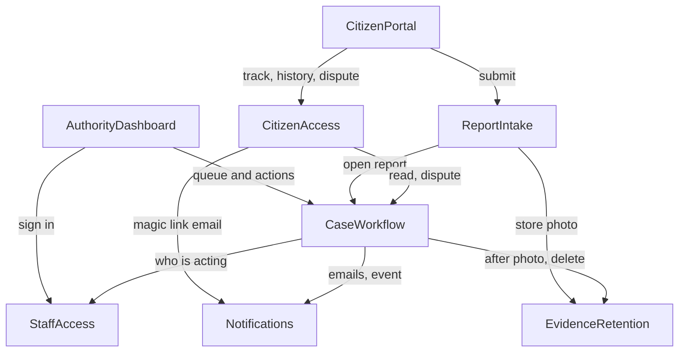

# Components — Civic Issue Tracker

Logical building blocks only: code we write. Databases, queues, object storage and the email service are dependencies of components, not components. Deployment grouping is decided in Units Generation.

Your choices from `domain-design-questions.md`: six domain components [Q1-B], status history inside each report [Q2-A], dispute as a flag [Q3-A], categories, zones and business hours owned by Case Workflow [Q4-A]. The two web surfaces are added as presentation components, so the catalogue has six domain components and two presentation components.

```yaml
components:
  - name: ReportIntake
    summary: Validates and screens a citizen submission, stores the photo and opens the report.
    behaviour: >
      Accepts category, description, location, an optional email and one photo.
      Validates the fields, rate-limits anonymous submissions per client, rejects
      automated abuse, and hands the photo to EvidenceRetention before opening the
      report in CaseWorkflow. Returns the Tracking ID and the confirmation text,
      including the no-email warning. Never stores report data itself.
    responsibilities:
      - Submission validation (category, location, photo type and size)
      - Abuse protection and rate limiting for anonymous submissions
      - Orchestrating photo storage and report creation as one citizen action
    depends_on:
      - component: CaseWorkflow
        interaction: open a new report and receive its Tracking ID
        style: sync
      - component: EvidenceRetention
        interaction: store the citizen photo before the report is opened
        style: sync
    dependents:
      - component: CitizenPortal
        interaction: submits reports on the citizen's behalf
    external_dependencies:
      - name: Rate-limit counter store
        kind: cache
        purpose: submissions per client per hour
    entities:
      - name: SubmissionAttempt
        identifier: attemptId
        attributes: [attemptId, clientKeyHash, attemptedAt, outcome]

  - name: CaseWorkflow
    summary: Owns every report, its status workflow, priority, dispute flag and history.
    behaviour: >
      The Report aggregate is the system of record for a report. Enforces the status
      rules: forward moves are one step; backward moves need a reason; Resolved needs
      a resolution note; Closed-Duplicate needs a link to the original. Every status
      change appends a StatusChange to the report in the same transaction, with
      timestamp and acting staff or system identity. Holds the dispute flag, internal
      notes, categories, zones and the business-hours calendar. Serves the triage
      queue with sorting, filtering and paging. Publishes a status-changed event
      carrying the data a notification needs. Purges personal data from closed reports
      when the retention period ends and tells EvidenceRetention to delete the photos.
    responsibilities:
      - Report lifecycle and the status rules
      - Status history and audit identity for every change
      - Priority, internal notes, resolution note, dispute flag and reopen
      - Triage queue, filters and paging
      - Categories, zones and business-hours configuration
      - Retention purge of personal data on closed reports
    depends_on:
      - component: StaffAccess
        interaction: confirm the acting staff identity and that the staff account is active
        style: sync
      - component: Notifications
        interaction: request acknowledgement and status-change emails
        style: event
      - component: EvidenceRetention
        interaction: store the after photo and delete photos when the retention period ends
        style: sync
    dependents:
      - component: ReportIntake
        interaction: opens reports
      - component: CitizenAccess
        interaction: reads tracking views and records disputes
      - component: AuthorityDashboard
        interaction: queue, triage and status actions
    external_dependencies:
      - name: Relational database
        kind: database
        purpose: reports, history, configuration
      - name: Scheduler
        kind: other
        purpose: daily retention purge run
    entities:
      - name: Report
        identifier: trackingId
        attributes: [trackingId, category, description, location, zone, contactEmail, photoRef, afterPhotoRef, status, priority, disputed, resolutionNote, duplicateOfTrackingId, submittedAt, closedAt]
        references:
          - entity: Photo
            owned_by: EvidenceRetention
            relationship: each Report has at most one original photo and at most one after photo
      - name: StatusChange
        identifier: reportId plus sequence number
        attributes: [trackingId, sequence, fromStatus, toStatus, reason, changedAt, actorType, actorStaffId]
        references:
          - entity: StaffAccount
            owned_by: StaffAccess
            relationship: a staff-made change names the staff account that made it; a system change has none
      - name: InternalNote
        identifier: noteId
        attributes: [noteId, trackingId, text, createdAt, authorStaffId]
      - name: Category
        identifier: categoryCode
        attributes: [categoryCode, label, active]
      - name: Zone
        identifier: zoneCode
        attributes: [zoneCode, label]
      - name: BusinessCalendar
        identifier: calendarId
        attributes: [calendarId, timeZone, workingDays, openTime, closeTime, holidays]

  - name: CitizenAccess
    summary: Lets a citizen look up a report by Tracking ID or by emailed magic link, and dispute a resolution.
    behaviour: >
      Serves the public tracking view with the fields the privacy decision allows:
      exact pin public, citizen photo staff-only. Issues single-use, short-lived,
      rate-limited magic links to an email address and lists the reports linked to
      it. Rate-limits Tracking ID lookups so IDs cannot be enumerated. Accepts the
      dispute action only while a report is Resolved and passes it to CaseWorkflow.
    responsibilities:
      - Public tracking view by Tracking ID
      - Magic-link issue, redemption and rate limiting
      - Personal history list for citizens who gave an email
      - Dispute action entry point
    depends_on:
      - component: CaseWorkflow
        interaction: read the tracking view and personal history, record a dispute
        style: sync
      - component: Notifications
        interaction: send the magic-link email
        style: sync
    dependents:
      - component: CitizenPortal
        interaction: tracking page, personal history and dispute screens
    external_dependencies:
      - name: Rate-limit counter store
        kind: cache
        purpose: lookups per client and magic-link requests per email
    entities:
      - name: MagicLink
        identifier: linkId
        attributes: [linkId, emailHash, tokenHash, issuedAt, expiresAt, redeemedAt]

  - name: Notifications
    summary: Sends citizen emails reliably and records the outcome.
    behaviour: >
      Receives notification requests that carry everything needed to build the email
      (Tracking ID, new status, timestamp, link, recipient). Sends nothing when no
      recipient exists. Retries failed sends with capped backoff and keeps the
      delivery outcome, including bounces. Acknowledgement emails are sent within 60
      seconds and status emails within 5 minutes while the platform is up.
    responsibilities:
      - Email templates for acknowledgement, status change and magic link
      - Reliable delivery with retry and delivery outcome tracking
    depends_on: []
    dependents:
      - component: CaseWorkflow
        interaction: acknowledgement and status-change emails
      - component: CitizenAccess
        interaction: magic-link emails
    external_dependencies:
      - name: Email delivery service
        kind: third-party-api
        purpose: outbound email
      - name: Message queue
        kind: queue
        purpose: decouple requests from sending and retry
    entities:
      - name: NotificationRequest
        identifier: notificationId
        attributes: [notificationId, kind, trackingId, recipientEmail, payload, status, attempts, lastAttemptAt, deliveryOutcome]

  - name: StaffAccess
    summary: Invited staff accounts, sign-in with a second factor, and who may act.
    behaviour: >
      Staff accounts are created by invitation only; there is no self-registration.
      Sign-in needs a password and a second factor. Deactivating an account stops
      access at once but keeps the account record, so history still names the actor.
      Exposes the identity and active state of an account to other components.
    responsibilities:
      - Invitation, activation and deactivation of staff accounts
      - Password and second-factor sign-in, session lifetime
      - Identity lookup for audit attribution
    depends_on: []
    dependents:
      - component: CaseWorkflow
        interaction: acting-user check on every staff action
      - component: AuthorityDashboard
        interaction: sign-in and session
    external_dependencies:
      - name: Managed identity service
        kind: third-party-api
        purpose: password and second-factor authentication
    entities:
      - name: StaffAccount
        identifier: staffId
        attributes: [staffId, email, displayName, active, mfaEnrolled, invitedBy, createdAt, deactivatedAt]
      - name: Invitation
        identifier: invitationId
        attributes: [invitationId, email, tokenHash, issuedAt, expiresAt, acceptedAt]

  - name: EvidenceRetention
    summary: Stores photos safely and removes them when told or when they expire.
    behaviour: >
      Accepts one photo per upload (JPEG, PNG or HEIC up to 10 MB), checks it for
      malware, strips embedded location metadata and stores it privately. Photos are
      served only to staff through short-lived links; the public never receives them.
      Deletes a photo when CaseWorkflow says so, and independently expires any photo
      that was never attached to a report after 24 hours.
    responsibilities:
      - Photo intake checks (type, size, malware, metadata stripping)
      - Private storage and staff-only access
      - Deletion on instruction and expiry of unattached photos
    depends_on: []
    dependents:
      - component: ReportIntake
        interaction: stores the citizen photo
      - component: CaseWorkflow
        interaction: stores the after photo, deletes photos at retention end
    external_dependencies:
      - name: Private object storage
        kind: object-store
        purpose: photo files
      - name: Malware scanning
        kind: third-party-api
        purpose: scan uploads before they are served
    entities:
      - name: Photo
        identifier: photoId
        attributes: [photoId, kind, contentType, sizeBytes, storageKey, uploadedAt, attachedAt, scanResult, deletedAt]

  - name: CitizenPortal
    summary: The public web surface for reporting and tracking.
    behaviour: >
      Responsive pages for the report form, confirmation, tracking, personal history
      and dispute. Meets WCAG 2.2 level AA. Offers a draggable pin when geolocation
      is denied. Holds no data of its own.
    responsibilities:
      - Report form, confirmation and no-email warning
      - Tracking page, personal history and dispute screens
      - Accessibility and mobile layout
    depends_on:
      - component: ReportIntake
        interaction: submit a report
        style: sync
      - component: CitizenAccess
        interaction: tracking, history and dispute
        style: sync
    dependents: []
    entities: []

  - name: AuthorityDashboard
    summary: The staff web surface for triage and resolution.
    behaviour: >
      Triage queue with sorting, filters and paging; one-click Acknowledge; priority;
      status moves with required notes; resolution note and after photo; reopen of
      disputed reports; staff sign-in. Meets WCAG 2.2 level AA. Holds no data of its
      own.
    responsibilities:
      - Queue, filters and report detail
      - Acknowledge, priority, status, resolution and reopen actions
      - Staff sign-in screens
    depends_on:
      - component: CaseWorkflow
        interaction: queue and all report actions
        style: sync
      - component: StaffAccess
        interaction: sign in and session
        style: sync
    dependents: []
    entities: []
```

## Component Diagram



Text fallback: the two surfaces call the domain components; ReportIntake and CitizenAccess call CaseWorkflow; CaseWorkflow calls StaffAccess, Notifications and EvidenceRetention; ReportIntake also calls EvidenceRetention; CitizenAccess also calls Notifications. Nothing calls back up: the graph has no cycle.

## Component Summary

| Component | Purpose | Depends On | Dependents | Entities Owned |
|---|---|---|---|---|
| ReportIntake | Validate, screen and open a submission | CaseWorkflow, EvidenceRetention | CitizenPortal | SubmissionAttempt |
| CaseWorkflow | Reports, status rules, history, queue, configuration, retention purge | StaffAccess, Notifications, EvidenceRetention | ReportIntake, CitizenAccess, AuthorityDashboard | Report, StatusChange, InternalNote, Category, Zone, BusinessCalendar |
| CitizenAccess | Tracking view, magic links, dispute entry | CaseWorkflow, Notifications | CitizenPortal | MagicLink |
| Notifications | Reliable citizen email | none | CaseWorkflow, CitizenAccess | NotificationRequest |
| StaffAccess | Invited staff accounts and sign-in | none | CaseWorkflow, AuthorityDashboard | StaffAccount, Invitation |
| EvidenceRetention | Private photo storage, checks, deletion | none | ReportIntake, CaseWorkflow | Photo |
| CitizenPortal | Public web surface | ReportIntake, CitizenAccess | none | none |
| AuthorityDashboard | Staff web surface | CaseWorkflow, StaffAccess | none | none |

## Entity Ownership

| Entity | Owning Component | Identifier | Attributes | References |
|---|---|---|---|---|
| Report | CaseWorkflow | trackingId | trackingId, category, description, location, zone, contactEmail, photoRef, afterPhotoRef, status, priority, disputed, resolutionNote, duplicateOfTrackingId, submittedAt, closedAt | Photo (EvidenceRetention) |
| StatusChange | CaseWorkflow | reportId plus sequence number | trackingId, sequence, fromStatus, toStatus, reason, changedAt, actorType, actorStaffId | StaffAccount (StaffAccess) |
| InternalNote | CaseWorkflow | noteId | noteId, trackingId, text, createdAt, authorStaffId | none |
| Category | CaseWorkflow | categoryCode | categoryCode, label, active | none |
| Zone | CaseWorkflow | zoneCode | zoneCode, label | none |
| BusinessCalendar | CaseWorkflow | calendarId | calendarId, timeZone, workingDays, openTime, closeTime, holidays | none |
| SubmissionAttempt | ReportIntake | attemptId | attemptId, clientKeyHash, attemptedAt, outcome | none |
| MagicLink | CitizenAccess | linkId | linkId, emailHash, tokenHash, issuedAt, expiresAt, redeemedAt | none |
| NotificationRequest | Notifications | notificationId | notificationId, kind, trackingId, recipientEmail, payload, status, attempts, lastAttemptAt, deliveryOutcome | none |
| StaffAccount | StaffAccess | staffId | staffId, email, displayName, active, mfaEnrolled, invitedBy, createdAt, deactivatedAt | none |
| Invitation | StaffAccess | invitationId | invitationId, email, tokenHash, issuedAt, expiresAt, acceptedAt | none |
| Photo | EvidenceRetention | photoId | photoId, kind, contentType, sizeBytes, storageKey, uploadedAt, attachedAt, scanResult, deletedAt | none |

## External Dependencies

| Component | Dependency | Kind | Purpose |
|---|---|---|---|
| ReportIntake | Rate-limit counter store | cache | submissions per client per hour |
| CaseWorkflow | Relational database | database | reports, history, configuration |
| CaseWorkflow | Scheduler | other | daily retention purge run |
| CitizenAccess | Rate-limit counter store | cache | lookups per client, magic-link requests per email |
| Notifications | Email delivery service | third-party-api | outbound email |
| Notifications | Message queue | queue | decouple and retry sends |
| StaffAccess | Managed identity service | third-party-api | password and second-factor sign-in |
| EvidenceRetention | Private object storage | object-store | photo files |
| EvidenceRetention | Malware scanning | third-party-api | scan uploads |

## Rationale

| Component | Why it is separate |
|---|---|
| ReportIntake | Changes for abuse rules and form validation, a different reason and rate than workflow rules; owns no report data. |
| CaseWorkflow | Owns the report and every rule about it; status rules, history and queue all change together, so they stay one component. |
| CitizenAccess | Public, unauthenticated surface with its own threats (enumeration, link abuse); changes independently of staff workflow. |
| Notifications | Different lifecycle (retry, bounce, templates, a third-party dependency) and the one place that touches citizen email delivery. |
| StaffAccess | Authentication and account lifecycle change for security reasons and could be replaced by city single sign-on without touching workflow. |
| EvidenceRetention | Handles untrusted files with its own checks and a different retention clock; isolates malware risk from report data. |
| CitizenPortal and AuthorityDashboard | Two audiences, two accessibility and layout needs, no shared screens. |

Alternatives rejected for the decomposition (coarse four-component and fine eight-component options, separate audit and reference-data components) are recorded in `decisions.md`, ADR-001 to ADR-004.

## Sources

- `requirements.md` (FR1–FR18, NFR1–NFR16) [requirements]
- `domain-design-questions.md` (Q1–Q4)
