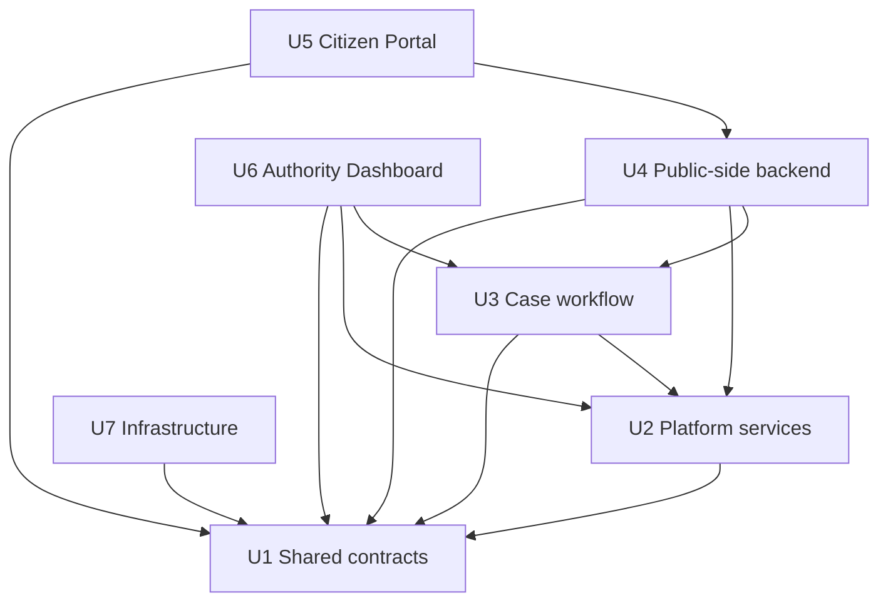

# Unit Dependencies — Civic Issue Tracker

This file shows what depends on what. It does not pick a build order or a critical path; Delivery Planning (stage 2.9) does that.

## Dependency graph

An arrow `A --> B` means "A depends on B".



Text fallback: U1 depends on nothing. U2 depends on U1. U3 depends on U1 and U2. U4 depends on U1, U2 and U3. U5 depends on U1 and U4. U6 depends on U1, U2 and U3. U7 depends on U1. No unit depends on itself and there is no cycle: every arrow points to a lower-numbered unit.

## Why each edge exists

| Edge | Reason | Component link |
|---|---|---|
| U2 → U1 | Platform services implement contracts written in U1 | contracts |
| U3 → U2 | CaseWorkflow checks the acting staff identity, requests emails and stores and deletes photos | CaseWorkflow → StaffAccess, Notifications, EvidenceRetention |
| U4 → U3 | ReportIntake opens reports; CitizenAccess reads tracking views and records disputes | ReportIntake, CitizenAccess → CaseWorkflow |
| U4 → U2 | ReportIntake stores the photo; CitizenAccess sends the magic-link email | ReportIntake → EvidenceRetention; CitizenAccess → Notifications |
| U5 → U4 | The Citizen Portal calls ReportIntake and CitizenAccess | CitizenPortal → ReportIntake, CitizenAccess |
| U6 → U3 | The Authority Dashboard runs the queue and every report action through CaseWorkflow | AuthorityDashboard → CaseWorkflow |
| U6 → U2 | The Authority Dashboard signs staff in through StaffAccess | AuthorityDashboard → StaffAccess |
| U3, U4, U5, U6 → U1 | Each calls across a seam that U1 defines | contracts |
| U7 → U1 | Deployment definitions use the contract and event names | contracts |

## Integration points

| Between | Mechanism | What crosses | Contract owner |
|---|---|---|---|
| U5 and U4 | synchronous web calls | submission, tracking view, magic-link request, dispute | U1 (written in Contract Design) |
| U6 and U3 | synchronous web calls | queue, filters, report detail, status and priority actions | U1 |
| U6 and U2 | synchronous web calls | staff sign-in and session | U1 |
| U4 and U3 | in-process call inside the one backend service | open a report, read a tracking view, record a dispute | U1 |
| U4 and U2 | in-process call inside the backend service | store a photo; send a magic-link email | U1 |
| U3 and U2 | in-process call, plus the status-changed event | staff identity check, after photo, photo deletion; email request | U1 |

The mechanism per seam is a starting position; Contract Design (stage 2.8) fixes it.

## Parallel development opportunities

These sets of units have no dependency between them, so they can be developed side by side once U1 exists.

- U2 and U7
- U3 and U7 (once U2 exists)
- U4, U6 and U7 (once U3 exists)
- U5, U6 and U7 (once U4 exists)

Several valid topological orderings exist.

## Edge block

```yaml
units:
  - name: u1-contracts
    kind: spec
    depends_on: []
  - name: u2-platform-services
    kind: service
    depends_on: [u1-contracts]
  - name: u3-case-workflow
    kind: service
    depends_on: [u1-contracts, u2-platform-services]
  - name: u4-public-backend
    kind: service
    depends_on: [u1-contracts, u2-platform-services, u3-case-workflow]
  - name: u5-citizen-portal
    kind: ui
    depends_on: [u1-contracts, u4-public-backend]
  - name: u6-authority-dashboard
    kind: ui
    depends_on: [u1-contracts, u2-platform-services, u3-case-workflow]
  - name: u7-infrastructure
    kind: packaging
    depends_on: [u1-contracts]
```

## Sources

- `unit-of-work.md` (units, kinds) [unit-of-work]
- `components.md` (component dependencies) [components]
- `decisions.md` (ADR-001, ADR-006) [decisions]
- `units-generation-questions.md` (Q3, Q5) [Q3], [Q5]

## Assumptions & Open Questions

- None.
