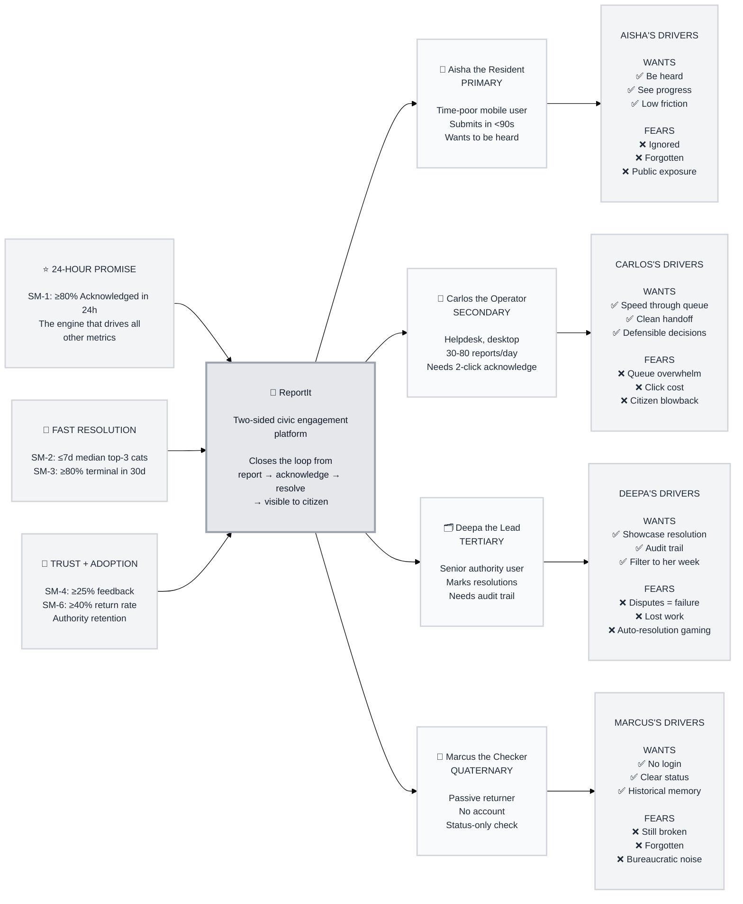

# Trigger Map: ReportIt (Local Civic Issue Reporter & Tracker)

> Connect business goals to user psychology — understand why people act, not just what they do.

**Created:** 2026-09-11
**Phase:** 2 — Trigger Mapping (backfilled from brief + PRD)
**Author:** Tauhid5555
**Methodology:** Based on Effect Mapping (Balic & Domingues), adapted for WDS framework

> **Backfill note:** This Trigger Map was generated on 2026-09-11 from sources already produced for the project:
> - Product Brief (`_bmad-output/planning-artifacts/briefs/brief-Civic-Issue-Tracker-2026-08-30/brief.md`)
> - PRD (`_bmad-output/planning-artifacts/prds/prd-Civic-Issue-Tracker-2026-08-30/prd.md`)
>
> Personas, driving forces, and feature impact were synthesized from the persona-grounded user journeys (UJ-1..UJ-4) in PRD §2.3, the JTBD analysis in PRD §2.1, the success metrics in PRD §7, and the brief's "Who This Serves" section. This artifact was created retroactively to provide strategic grounding for the existing Phase 4 scenario designs.

---

## Strategic Documents

This is the visual overview. For detailed documentation, see:

- **01-Business-Goals.md** — Full vision statements and SMART objectives
- **02-Target-Groups.md** — All personas with complete driving forces
- **03-Feature-Impact-Analysis.md** — Prioritized features with impact scores
- **04-Aisha-the-Resident.md** — Primary persona (resident citizen)
- **05-Carlos-the-Operator.md** — Secondary persona (helpdesk operator)
- **06-Deepa-the-Department-Lead.md** — Tertiary persona (senior authority user)
- **07-Marcus-the-Occasional-Checker.md** — Quaternary persona (passive returner)
- **08-Key-Insights.md** — Strategic implications

---

## Vision

ReportIt is a web-based, two-sided civic engagement platform that closes the loop between residents reporting neighborhood problems and municipal authorities resolving them — the accountability layer that turns helplines and fragmented community posts into a visible, status-tracked pipeline from "I noticed a problem" to "It's fixed."

---

## Business Objectives

### ⭐ PRIMARY GOAL: 24-Hour Acknowledgement (THE ENGINE)

- **Statement:** Within 24 hours of a citizen submitting a report, they feel "received, being looked at, will not be forgotten."
- **Metric:** SM-1 — % of reports reaching Acknowledged within 24 hours
- **Target:** ≥ 80% of reports acknowledged within 24h of submission (PRD §7)
- **Timeline:** Pilot-then-scale; SM-1 tracked from v1 launch
- **Impact:** This drives ALL other objectives — without acknowledgment, the loop never closes and citizens disengage

---

### 🚀 OPERATIONAL GOALS (Driven by 24h Acknowledgement)

**Objective 1: Fast Resolution**
- **Statement:** Top-3 categories resolve in ≤ 7 days median
- **Metric:** SM-2 — Median time Submitted → Resolved
- **Target:** ≤ 7 days (PRD §7)
- **Timeline:** Measured continuously post-pilot

**Objective 2: Terminal State Coverage**
- **Statement:** ≥ 80% of reports reach a terminal status (Resolved or Closed-Duplicate) within 30 days
- **Metric:** SM-3 — % reports at terminal status ≤ 30 days
- **Target:** ≥ 80%
- **Timeline:** 30-day rolling window

**Objective 3: Citizen Feedback Loop**
- **Statement:** Citizens actively confirm or dispute resolutions
- **Metric:** SM-4 — % of resolved reports receiving confirmation/dispute
- **Target:** ≥ 25%
- **Timeline:** Tracked from launch

---

### 🌟 TRUST GOALS (Real-World Benefits for Citizens and Authorities)

**Objective A: Citizen Return Behavior**
- **Statement:** Reporters come back to check status
- **Metric:** SM-6 — % reporters returning to view status at least once
- **Target:** ≥ 40%
- **Timeline:** Tracked from launch

**Objective B: Notification Reliability**
- **Statement:** Status-change notifications are delivered consistently
- **Metric:** SM-7 — Notification delivery rate
- **Target:** ≥ 95% within 5 minutes (PRD §7)
- **Timeline:** Tracked continuously

**Objective C: Authority Adoption**
- **Statement:** Authority staff actively use the dashboard rather than reverting to spreadsheets
- **Metric:** R-1 mitigation — qualitative; pilot retention
- **Target:** Pilot partner commits to dashboard as primary intake within 6 months
- **Timeline:** Pilot completion + 3 months

---

## The Flywheel: How Goals Connect

**THE ENGINE (Priority #1): 24-Hour Acknowledgement**
- First-time reporters (Aisha) submit, see Acknowledged, return, tell neighbors.
- Repeat reporters (Marcus) become expected behavior, not effort.
- Acknowledged reports get priority routing → resolved faster → more SM-2 wins.

**Operational Goals (Priority #2):**
- Driven BY fast acknowledgement (reports acknowledged quickly are the ones that get resolved quickly).
- Authority dashboard efficiency (FR-9 two-click acknowledge) is the lever.
- Without acknowledgment, the queue grows and staff revert to spreadsheets (R-2).

**Trust Goals (Priority #3):**
- Real-world benefits FOR citizens (visible progress, return behavior) AND authorities (less spreadsheet overhead, demonstrable responsiveness).
- Trust compounds: more citizens report → more authority activity → more "fixed" stories → more trust → more reports.

---

## Target Groups (Prioritized)

### 1. Aisha the Active Reporter

**Priority Reasoning:** She is the **primary trigger source** — the person whose report, acknowledged in time, creates the visible momentum that drives every other metric.

> Aisha is a neighborhood resident who notices a problem (broken streetlight, pothole, garbage pile) and reports it through the Citizen Portal. Time-poor, mobile-first, browser-only, low technical tolerance. Wants to be heard and to see something happen.

**Key Positive Drivers:**
- ✅ **Be heard / feel acknowledged** — Someone at the city saw her report and is doing something about it
- ✅ **See progress** — A status that moves from Submitted to Acknowledged to Resolved without her chasing
- ✅ **Low friction** — Submit a report on her phone in under 90 seconds, no account, no app install

**Key Negative Drivers:**
- ❌ **Ignored** — Reporting into a void; helpline wait time, no ticket number, no follow-up
- ❌ **Forgetfulness** — The city forgot about her report; she gives up
- ❌ **Public exposure** — Photo and location reveal her identity or her home; she self-censors

---

### 2. Carlos the Queue Operator

**Priority Reasoning:** He is the **fulfillment engine** — without Carlos acknowledging quickly, SM-1 (the primary goal) fails. Authority adoption (R-1) is won or lost on his daily experience.

> Carlos is a municipal helpdesk operator who starts each day with 30–80 new reports to triage on desktop. Needs to move reports out of "Submitted" quickly. His morning routine IS the 24-hour promise.

**Key Positive Drivers:**
- ✅ **Speed through the queue** — Acknowledge 30+ reports in under 5 minutes total
- ✅ **Clean handoff** — A clear priority and category so the right team gets dispatched
- ✅ **Defensible decisions** — Every action is auditable; no citizen disputes or supervisor pushback

**Key Negative Drivers:**
- ❌ **Queue overwhelm** — Reports pile up faster than he can clear them; he falls back to the spreadsheet
- ❌ **Click cost** — Every acknowledge takes 6 clicks; he cannot scale
- ❌ **Citizen blowback** — Without status updates, citizens call him directly and he becomes the complaint desk

---

### 3. Deepa the Department Lead

**Priority Reasoning:** She is the **closer** — the user who marks resolutions and demonstrates accountability. Without her resolution notes, the citizen loop never reaches "Resolved" with evidence.

> Deepa is a senior authority user reviewing resolved cases at end of week. She demonstrates what was done. Spreadsheet-fluent; treats the dashboard as a faster replacement, not a new system.

**Key Positive Drivers:**
- ✅ **Showcase resolution** — Before/after notes + photo she can refer back to
- ✅ **Audit trail** — Every status change attributed to her is her professional record
- ✅ **Filter to her week** — Quickly see what she and her team closed

**Key Negative Drivers:**
- ❌ **Disputes surface as failure** — Citizens disputing her resolutions feel like personal criticism
- ❌ **Lost work** — Re-entering resolution notes into spreadsheets after closing them in the dashboard
- ❌ **Auto-resolution gaming** — System makes it tempting to mark duplicates or auto-close, eroding the data quality she depends on

---

### 4. Marcus the Occasional Checker

**Priority Reasoning:** He is the **passive retention signal** — his return behavior validates that the loop is visible and worth trusting. His SM-6 return rate is the leading indicator of long-term trust.

> Marcus submitted a pothole report three weeks ago and forgot about it. He returns via the bookmarked tracking link or the email deep link, sees status, and exits satisfied — or dissatisfied. He does not need an account.

**Key Positive Drivers:**
- ✅ **No login** — Bookmark + tracking ID is enough
- ✅ **Clear status** — One glance tells him "fixed" or "still in progress"
- ✅ **Historical memory** — Sees his past reports when he returns

**Key Negative Drivers:**
- ❌ **Still broken** — Reports shows "In Progress" indefinitely with no updates
- ❌ **Forgotten** — No notification when status changes
- ❌ **Bureaucratic noise** — Government form-heavy UI that buries the status

---

## Trigger Map Visualization

---

## Design Focus Statement

**Primary Design Target:** Aisha the Resident — the trigger source. Every page spec must reduce the time from noticing to feeling-heard. The Citizen Portal's submit flow, tracking page, and email notifications all serve her drivers.

**Must Address:**
- ✅ Acknowledge within 24 hours (FR-6, FR-9) — drives SM-1, satisfies Aisha's "be heard" + Carlos's "queue speed"
- ✅ Visible status progression (FR-3, FR-5) — drives Aisha's "see progress" + Marcus's "clear status"
- ✅ Low-friction submission (FR-1, FR-2) — drives Aisha's "low friction", supports SM-5
- ✅ Two-click acknowledge (FR-9) — drives Carlos's "speed through queue", enables SM-1

**Should Address:**
- 🔶 Personal history without login (FR-4) — addresses Marcus's "no login" + "historical memory"
- 🔶 Dispute + reopen (FR-13, FR-14) — addresses Deepa's "defensible decisions" + Marcus's "still broken" fear
- 🔶 Resolution notes + after-photo (FR-12) — addresses Deepa's "showcase resolution" + Aisha's "see progress"
- 🔶 Privacy controls (NFR-6, NFR-7) — addresses Aisha's "public exposure" fear

---

## Cross-Group Patterns

### Shared Drivers

- **Visibility of progress** (Aisha, Marcus) — Status timeline + notifications
- **Auditability** (Carlos, Deepa) — Every action attributed + timestamped (NFR-5)
- **Friction reduction** (Aisha — submit; Carlos — acknowledge; Marcus — return) — UX density and one-click patterns across both portals

### Unique Drivers

- **Aisha only:** Public exposure / privacy
- **Carlos only:** Queue overwhelm / spreadsheet fallback
- **Deepa only:** Auto-resolution gaming (SM-C3 counter-metric)
- **Marcus only:** "Still broken" with no timeline (depends on status-update frequency)

### Potential Tensions

- **Speed vs. accuracy (Carlos):** Two-click acknowledge is fast but must require enough context to prevent auto-resolve gaming (SM-C3). Tension resolved by *requiring* a resolution note only at the Resolved transition (FR-12), not at Acknowledge.
- **Citizen visibility vs. authority workload (Aisha vs. Carlos):** More notifications = more visible progress for Aisha, but more emails to manage if Carlos changes status noisily. Tension resolved by **batching** status-change notifications (≥30-min window per PRD §email design) and only notifying on substantive transitions.
- **Anonymity vs. accountability per category:** Noise complaints benefit from anonymity; infrastructure reports benefit from accountability. Tension deferred to **Open Question OQ-3** in PRD §8.

---

## Success Metrics Alignment

### How Trigger Map Connects to Objectives (Properly Prioritized):

**⭐ PRIMARY: 24-Hour Acknowledgement → Achieves:**
- ✅ SM-1 ≥ 80% acknowledged in 24h (THE ENGINE — Carlos's morning batch makes this happen)
- ✅ FR-6 + FR-9 enforce SLA and enable it
- ✅ Authority adoption (R-1 mitigation)
- ✅ Citizen trust compounding (Aisha's "be heard" satisfied → she reports again)

**🚀 OPERATIONAL: Fast Resolution → Achieves:**
- ✅ SM-2 ≤ 7d median for top-3 categories
- ✅ SM-3 ≥ 80% terminal status within 30d
- ✅ Deepa's resolution workflow supports both
- ✅ Risk R-2 (volume spike) mitigated by FR-7 + FR-8 sort/filter

**🌟 TRUST + ADOPTION: Real-World Benefits → Achieves:**
- ✅ SM-4 ≥ 25% citizen feedback (dispute or confirm)
- ✅ SM-6 ≥ 40% reporter return
- ✅ Marcus's passive return behavior validates the loop
- ✅ Authority staff stay because the dashboard is genuinely faster (R-1 mitigated)

**The Trigger Map IS the Strategic Foundation — And Prioritization Matters**

The page must empower Aisha (citizen) → make her feel heard → she returns (Marcus) → returns trigger more reports → more reports need Carlos (operator) → Carlos's queue drives Deepa's resolutions → resolutions are visible → Aisha trusts more → loop compounds.

---

## Documents

| # | Document | Purpose | Status |
|---|----------|---------|--------|
| 01 | Business Goals | Vision, objectives, metrics | Complete (backfilled) |
| 02 | Target Groups | All personas summary | Complete (backfilled) |
| 03 | Feature Impact Analysis | Forces × features scoring | Complete (backfilled) |
| 04 | Aisha the Resident | Primary persona | Complete (backfilled) |
| 05 | Carlos the Operator | Secondary persona | Complete (backfilled) |
| 06 | Deepa the Department Lead | Tertiary persona | Complete (backfilled) |
| 07 | Marcus the Occasional Checker | Quaternary persona | Complete (backfilled) |
| 08 | Key Insights | Strategic implications | Complete (backfilled) |

---

## Next Steps

This Trigger Map Poster provides a quick reference. For detailed work:

- [x] **Review detailed docs** — See 01-Business-Goals.md, 02-Target-Groups.md, 03-Feature-Impact-Analysis.md
- [x] **Use for Feature Prioritization** — Reference feature impact scores
- [x] **Guide UX Design** — All Phase 4 page specs trace back to a driving force documented here
- [ ] **Validate with Users** — Run user research with real citizens and authority staff from a pilot partner
- [ ] **Update as Learnings Emerge** — This is a living document

---

_Created using Whiteport Design Studio (WDS) methodology — backfilled from brief + PRD on 2026-09-11_
_Trigger Mapping methodology credits: Effect Mapping by Mijo Balic & Ingrid Domingues (inUse), adapted with negative driving forces_
